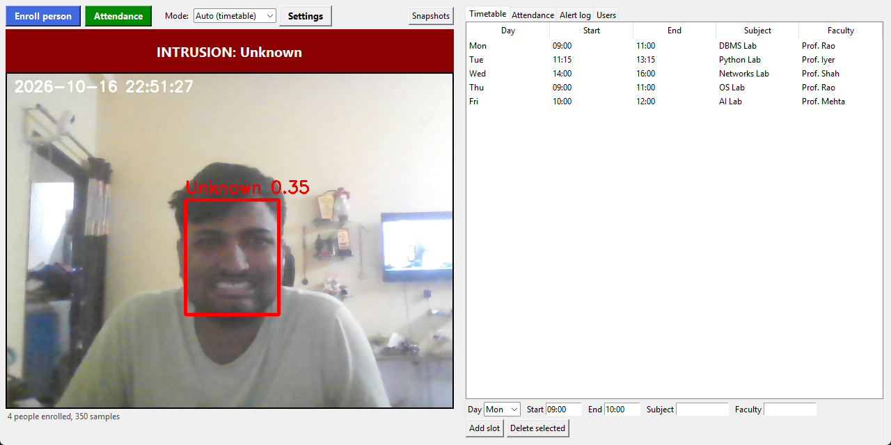
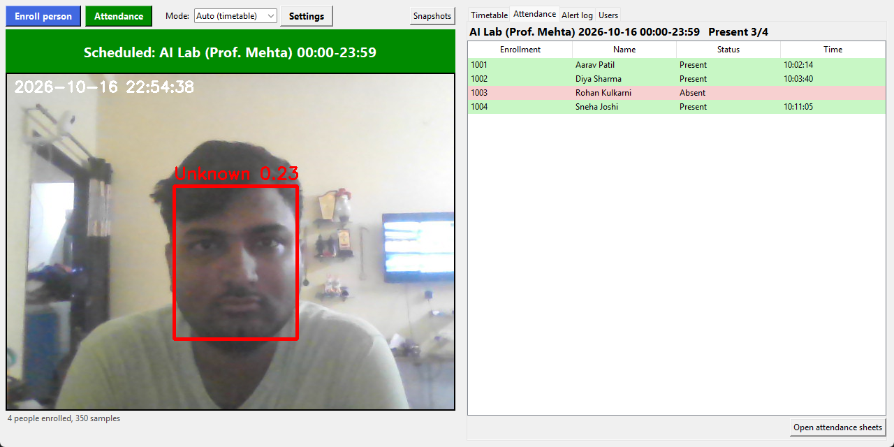
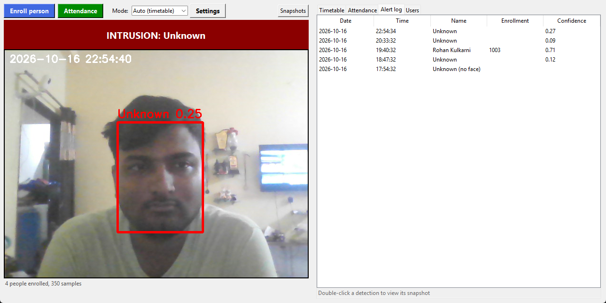
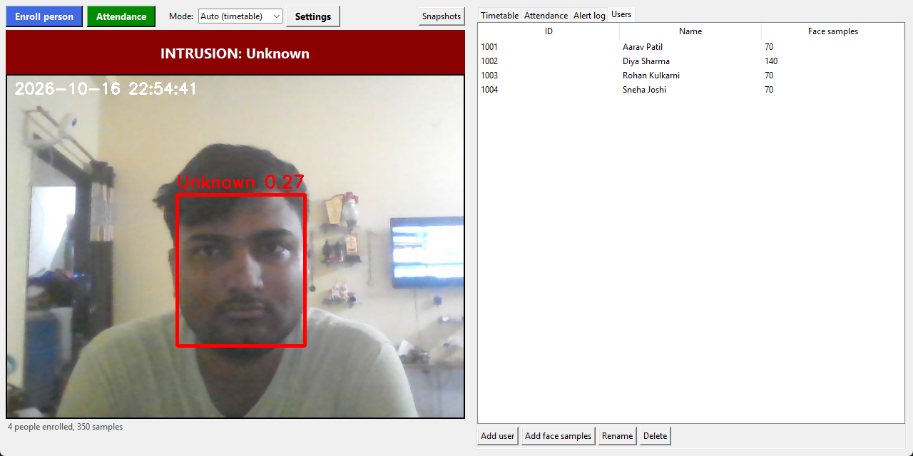
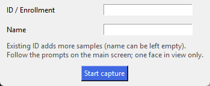
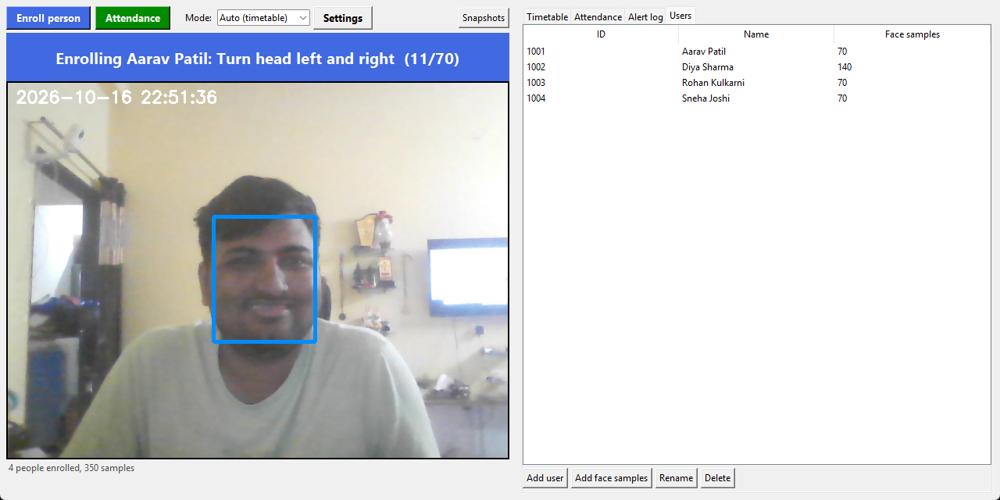
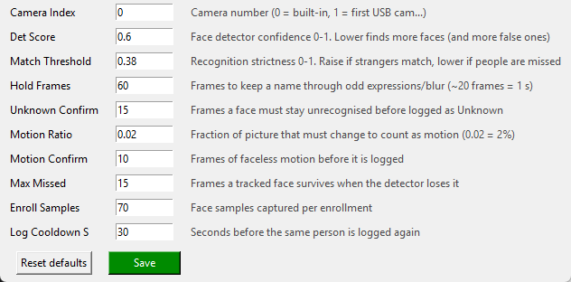

# Lab Occupancy Monitor + Face Recognition Attendance

A website that watches a lab with a webcam:
- **Booked slot (timetable):** recognised people are marked **present** for that class.
- **No class booked:** **alert mode**. Any presence (face or motion) is identified, timestamped and saved with a snapshot. If a **WiFi camera** is configured, it starts recording video of what happens.

Face pipeline: OpenCV YuNet detector + SFace recognizer, with tracking. It copes with expressions (tongue out, laughing), head turns and brief blur far better than the original Haar + LBPH.

### Install & run (Windows)
1. Install Python 3.9+ from python.org (tick **Add python.exe to PATH**).
2. Double-click **`install.bat`**. It creates `venv`, installs packages and downloads the face models.
3. Double-click **`run.bat`**. The website opens in your browser (http://localhost:5000).
4. First visit: create the admin password. This only works from the lab PC itself.
5. To stop it, run **`stop.bat`**.

To open it from a phone or laptop on the same WiFi, use `http://<lab-pc-ip>:5000` (find the IP with `ipconfig`). Allow Python through Windows Firewall when asked.

### Using it
| Where | What |
|---|---|
| **Enroll person** / Users → Add user | Enter ID + name, stand in front of the lab camera and follow the prompts in the status bar (straight, turn, tilt, smile, tongue out, talk...). 70 samples are captured. |
| Users | Add more face samples, rename, delete, **Make faculty** / **Make student** |
| Live counts (under the video) | People in lab, faculty, students (everyone not marked faculty, unknown faces included) and **Staff: Present / Absent**. Staff turns Absent `STAFF_ABSENT_S` seconds (default 10) after the last faculty face leaves view. Faculty are left out of student attendance. |
| Timetable | Add / delete lab slots, each with an optional **max students**. During the class the slot shows the live student count (e.g. `19/20`); above the limit the row turns red and the status bar shows **OVER LIMIT** |
| Attendance | Present / absent for the current class, plus downloadable sheets (`Attendance/<Subject>_<date>_<start>.csv`) |
| Alert log | Detections while the lab is not booked, with snapshots (`Intrusions/`) |
| Recordings | WiFi camera clips: play in the browser or download (`Recordings/*.webm`) |
| Mode | `Auto (timetable)`, `Always alert`, `Off` |
| Settings | Main camera picker, WiFi camera, PIR sensor, recognition strictness, motion sensitivity, recording length, password |

### Cameras
**Main camera (face recognition):** Settings -> *Scan cameras* shows a picture from every camera (0, 1, 2...). Click one, then save.

**WiFi camera (second camera, also records on alert):** it does everything the main camera does (face recognition, people/faculty/student counts, attendance, alerts) and also records video when an alert fires. Its live view shows under the main video. A person seen by both cameras is counted once; unknown faces can't be matched between cameras, so the larger camera's unknown count is used. Settings -> WiFi camera. Pick the type and enter its IP address. Port, user, password and path are optional; leave them empty to use the type's defaults.

| Type | Example IP / notes |
|---|---|
| Phone: IP Webcam app (Android) | phone's IP shown in the app, port 8080 |
| IP / CCTV camera (RTSP) | camera IP, user + password, stream path from its manual (e.g. `stream1`) |
| ESP32-CAM | board's IP (CameraWebServer example, port 81) |
| Extra USB camera | camera number, e.g. `1` |
| Custom stream URL | any `rtsp://` or `http://` URL |

*Test (one frame)* checks the fields before saving; *Live view* shows the saved camera. Recording starts when an alert fires and continues until `record seconds` after the last presence (clips are split every `max clip s`). The camera stays connected while the monitor is awake (with a PIR sensor it sleeps with the main camera). Big streams are shrunk to 960 px wide for face detection; recordings keep full resolution. The camera password is never sent back to the browser.

### PIR sensor (ESP32 over UART) - energy saving
With a PIR sensor, the main camera and face model sleep until motion is detected.
1. Wire up to 4 PIRs to an ESP32: HC-SR501 `VCC->5V, GND->GND`, OUT -> GPIO 13 / 14 / 27 / 26 (AM312: VCC->3V3). Sensors take 30 s to warm up after power-on.
2. Flash [`esp32_pir/esp32_pir.ino`](esp32_pir/esp32_pir.ino) with Arduino IDE (board "ESP32 Dev Module").
3. Plug the ESP32 into the lab PC by USB. In Settings -> PIR sensor, pick its COM port (*Refresh ports* lists them) and save.

The ESP32 sends `MOTION` (and an `ALIVE` heartbeat every 10 s). The camera wakes on motion and stays on for `wake seconds` after the last motion, longer while anyone is still in view. Use **Wake camera** in the top bar to wake it by hand. **Fail-safe:** if the sensor is unplugged or silent for 30 s, the camera stays on.

### Screenshots
(Users, timetable and attendance rows are demo data. These show the earlier desktop version; the website has the same tabs.)

| | |
|---|---|
| Alert mode: lab not booked, stranger detected  | Class running: attendance  |
| Alert log  | Users  |
| Enroll dialog  | Enrolling with guided prompts  |
| Settings  | |

### Limits
- Not spoof-proof: a photo or phone screen of an enrolled face can fool it.
- Plain HTTP: anyone on the same network can sniff the password. Use it only on a trusted LAN; don't expose it to the internet.
- Flask's built-in server: fine for a few viewers at once.

---

# Original project: Face-Recognition-Attendance-Management-System
Attendance Management System based on Face Recognition using Python  and OpenCv  

### Sourcerer

### Code Requirements
- Opencv(`pip install opencv-python`)
- Tkinter(Available in python)
- PIL (`pip install Pillow`)
- Pandas(`pip install pandas`)

### What steps you have to follow??
- Download my Repository 
- Create a `TrainingImage` folder in a project.
- Open a `AMS_Run.py` and change the all paths with your system path
- Run `AMS_Run.py`.

### Project Structure

- After run you need to give your face data to system so enter your ID and name in box than click on `Take Images` button.
- It will collect 200 images of your faces, it save a images in `TrainingImage` folder
- After that we need to train a model(for train a model click on `Train Image` button.
- It will take 5-10 minutes for training(for 10 person data).
- After training click on `Automatic Attendance` ,it can fill attendance by your face using our trained model (model will save in `TrainingImageLabel` )
- it will create `.csv` file of attendance according to time & subject.
- You can store data in database (install wampserver),change the DB name according to your in `AMS_Run.py`.
- `Manually Fill Attendance` Button in UI is for fill a manually attendance (without facce recognition),it's also create a `.csv` and store in a database.

### Screenshots

### Basic UI

### When it Recognises me

### While filling automatic attendance

### Manually attendance filling UI

### Video demo

[Youtube](https://youtu.be/onms2KDOTtY)

### Notes
- It will require high processing power(I have 8 GB RAM)
- Noisy image can reduce the accuracy, so quality of images should be good.

